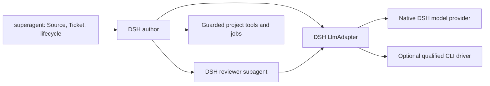

# Pluggable model transport

Status: **Execution authorized — TraeX, Codex, Claude and scoped OpenCode prototypes.** The user authorized implementation with a tracker, then selected Codex, Claude and now OpenCode; other CLI/provider combinations remain deferred. Each live profile still requires its own accepted finite qualification scope. Live qualification/deployment still requires the route-specific bindings and evidence below.
Created: 2026-11-16T17:08:15.204183-08:00. Updated: 2026-11-16T23:28:28.823593-08:00. Baseline: `de8ed8bb5fab6d346639c4d1e27ad37fa2bed8cc` (`origin/main`), helper `0.3.2`, research-loop contract `2.4.0`.

## Need and initial decision

Recommend a pluggable `LlmAdapter` seam, then at most one additional CLI driver in the first qualified prototype iteration. A second driver is justified by an **accepted requirement record**, not by its brand, lineage or a general intention to support more tools. Check whether an existing native DSH route meets that requirement before building a CLI bridge.

Rank candidate value against the actual research need:

- Improve reviewer error diversity or access to useful independent critique; assess actual defects/challenges and consequences.
- Obtain a needed model capability or justified cost advantage unavailable on existing qualified routes.
- Use an authorized credential/authentication route where a suitable API route is unavailable.
- Address an accepted availability/rate-limit need through explicit route selection, without automatic failover.

AUTH-1 requires separate reviewer authority under the qualified profile. Different vendors may reduce correlated errors; they neither guarantee statistical independence nor replace distinct Sessions, review policy and evidence. Same-provider/model review can satisfy qualified role separation. Do not make cross-vendor review mandatory or infer its scientific benefit from brand diversity alone.

Codex is now selected for the bounded prototype transport scope below. Concrete hosted-project/model/auth bindings still gate live adoption. Claude/OpenCode work remains deferred until a need is selected and accepted. Codex-shaped protocol reuse may lower implementation cost after selection; it does not establish need or upstream qualification. Prefer whichever route satisfies the accepted requirement. OpenCode and other broad provider surfaces remain deferred; a future single configured OpenCode-backed route may be evaluated on the same basis, without qualifying its entire provider matrix.

## Purpose and boundary

DSH and dsh-superagent retain author/reviewer Sessions, Tickets, tool execution, jobs and persistence. Reuse DSH's `LlmAdapter` interface and provider registry; add CLI bridges only for the selected model/authentication requirement.



This scope covers model transport, not delegation of the research agent to a CLI. It adds no scheduler, scientific ledger, provider dashboard or automatic cross-provider failover.

## Baseline coupling and verified limits

[TraexTextAdapter](https://github.com/hotneutron/dsh-research/blob/de8ed8bb5fab6d346639c4d1e27ad37fa2bed8cc/helpers/src/traex.ts) binds CLI argv, event parsing, completion/usage mapping and the configured DeepSeek model. [TraexToolAdapter](https://github.com/hotneutron/dsh-research/blob/de8ed8bb5fab6d346639c4d1e27ad37fa2bed8cc/helpers/src/traex-tools.ts) constructs that concrete text adapter before validating selections and emitting DSH tool blocks.

The [relay](https://github.com/hotneutron/dsh-research/blob/de8ed8bb5fab6d346639c4d1e27ad37fa2bed8cc/helpers/examples/traex-tools/relay.mjs) owns durable model-request accounting and service lifecycle; [remote-model.mjs](https://github.com/hotneutron/dsh-research/blob/de8ed8bb5fab6d346639c4d1e27ad37fa2bed8cc/helpers/examples/traex-tools/remote-model.mjs) also fixes the model. Context handling spans [traex-context.ts](https://github.com/hotneutron/dsh-research/blob/de8ed8bb5fab6d346639c4d1e27ad37fa2bed8cc/helpers/src/traex-context.ts) and the author/reviewer modules beside the relay. [The Source recipe](../helpers/examples/production/source.mjs) registers these routes for DSH agents.

The code speaks a Codex-shaped CLI protocol, but the baseline demonstrates TraeX and scripted fixtures, not a pinned upstream Codex release. A fork may add or change flags, events, context loading and usage; upstream support still requires exact-version verification.

Current request-model checks compare configured values, while receipts lack executable/version and provider-reported identity evidence. HTTP input is bounded by `maxRequestBytes`, but final CLI input has no independently declared total encoded-input bound. The relay tracks active requests without a declared concurrency ceiling. Missing/inconsistent required usage throws; the response is unusable and the dispatched request stays charged. These are gaps to address, not passing qualifications.

## Execution scope

The user first selected TraeX extraction and an isolated worktree, then requested Codex. Implementation/status are tracked in [the transport tracker](tracker/261117-0213-pluggable-model-transport.md). Baseline coupling links above retain the reviewed source revision; current API/export/consumer behavior is described in [integration guidance](../docs/integration.md#pluggable-model-transport). Codex mechanism qualification is tracked separately; other drivers and live route/cutover remain gated by the agreed requirements.

## Proposed composition

| Responsibility | Owner and proposed change |
|---|---|
| Research loop and authority | Existing DSH/superagent and dsh-research guards; retain ownership. |
| Model-provider registration | Existing DSH `llm` service; select the accepted project route. |
| Shared tool projection | Consume a text `LlmAdapter`, validate the complete selection, then emit DSH tool blocks. |
| CLI driver | Backend-specific executable/argv, authentication, context delivery, event parser, identity observations, usage and cancellation. |
| Context policy | Explicit project/profile selection, exposure inventory and lossless encoding; separate it from backend mechanics. |
| Accounting and lifecycle | Existing relay/receipts and service controls, with atomic preflight/admission and scoped concurrency. |

We are prototyping: there is no backward compatibility requirement. Replace/remove old exports, classes, configuration shapes, defaults and record formats as needed; add no compatibility aliases solely to preserve the prototype. Update the Source/relay consumers, [package exports](../helpers/package.json), examples/tests, [docs/integration.md](../docs/integration.md), [README usage](../README.md#using-an-autonomous-project-loop), [helpers/README.md](../helpers/README.md) and [milestone tracker](tracker/261105-1555-milestone-execution.md) together.

## Route contract and preflight

Bind each role's provider/model, driver implementation/version, effective executable distribution, configuration, context/exposure policy, authentication principal/use basis, separation basis, limits and qualification references in the accepted profile. Correlate DSH Session IDs, transport request IDs and CLI thread IDs without conflating them.

**Exposure:** declare allowed model-context content classes, prohibited classes, destination/provider scope and the project authority/exposure decision covering them. Inventory every selected block/artifact and automatic project instruction, memory, hook or plugin that can affect delivery. Classify scientific references and check permission before materializing protected content; an egress refusal does not undo a forbidden read. Unknown or uncovered content refuses before handing payload bytes to a CLI/vendor. Confirmation-off means protected bytes are never read into or sent as model context; authorized enabled releases may contribute only their permitted reviewed aggregates. Credential values never enter model context. An authenticated model route is not itself an exposure grant.

**Identity:** pin driver code and the effective executable/target/runtime hashes, not merely a mutable path or wrapper. Launch from the pinned distribution and retain observed executable/version evidence. Receipts distinguish configured/requested identity from provider-reported provider/model identity, including missing observations. Refuse local pin mismatches before dispatch; a conflicting reported model makes a dispatched response ineligible while retaining its charge. Missing provider-reported identity leaves the served-model property unqualified; a profile requiring that assurance cannot pass from echoed configuration. Review any narrower requested-model-only claim explicitly.

**Input:** declare positive finite `maxRequestBytes` for wire input and `maxEncodedInputBytes` for the total final delivered context after selection/framing, including stdin, context documents/attachments and approved automatic preload. Verify exact UTF-8 byte counts before CLI launch/model-request debit; refuse unknown or over-limit input with zero model dispatch/debit and a retained refusal record. Do not derive the declared budget from the payload or silently truncate/redact a frozen packet to fit. Input bounds are independent of uncapped output tokens.

**Authentication:** record authentication class, authorized principal and intended use modes, including unattended/shared use if claimed. Retain applicable provider/account/organization authorization or terms basis with its date/version and scope; an unresolved basis leaves that use unqualified. Refuse activation outside the covered use. Check the concrete route; neither permission nor prohibition follows solely from a CLI or subscription brand. Protected credential references stay private and are distinct from the relay's own token.

**Reviewer separation:** bind distinct author/reviewer DSH Sessions, reviewer preset, permissions, exact review evidence and qualified separation-policy reference. Record whether model/provider/principal are shared and why that arrangement satisfies the policy. Assess review usefulness/error diversity separately from formal role separation; CLI execution remains disabled and the reviewer cannot gain project tools through another driver.

**Concurrency:** declare positive finite `maxInFlightRequests` and its enforcement scope, including author/reviewer routes sharing the configured relay/auth principal. Atomically reserve capacity and durably admit the model request after all preflight gates. Initially refuse at capacity before model debit; add no transport queue. Existing DSH wake/reconciliation handles later work, and unknown requests hold their dependents. Do not claim account-wide rate control over clients outside the observed/enforced scope.

Each driver advertises only qualified text/structured output, logical role/context delivery, tool disabling, identity, completion/usage and cancellation capabilities. Unsupported required controls keep the route unqualified. Initial extraction uses the entire **approved** context losslessly; existing projections remain separately qualified policies. Round-trip checks prove representation fidelity, not identical reasoning or unobserved provider behavior.

Publish DSH selections only after a complete validated response. Missing/inconsistent required usage makes the response **ineligible**: retain failure, raw completion and any known usage; keep the dispatched request charged and emit no executable blocks. Never synthesize zeros. A different unknown-usage eligibility rule needs a deliberate contract/API decision and qualification before use. Retain uncapped output, explicit request/deadline/capture limits, actual C_qual/C_run costs and unresolved costs.

## Qualification portfolio and stopping rule

The initial proposal is TraeX plus at most one additional CLI implementation: **no more than two qualified CLI drivers per profile until actual qualification cost is measured**. Select one concrete alternative vendor/model/auth/context scope; a driver does not automatically qualify all models, accounts or modes it can reach. Native DSH routes also need evidence for any newly claimed scope.

An accepted requirement record names the gap/value, existing-route alternatives, selected scope, authorized principal/exposure, success evidence and owner. Before qualification, freeze a `qualification_budget_ref` covering required cells by claimed scope, distinct executions and cell mappings, setup/capture/storage/review costs, units/rates, failure/retry reserve, accepted ceilings and observation window. Verify actual available authority. Use an explicit union of required cells and justified shared evidence, not an automatic Cartesian product of every theoretical combination.

Stop adding drivers when the selected requirement is met. A further driver/scope requires a new accepted requirement, measured portfolio cost and a funded matrix review. If required cells exceed the accepted budget or remain unobservable, hold that route; do not omit failed cells, refund earlier requests, extend spend automatically or call the shortfall scientific exhaustion. This portfolio proposal is not spending authorization.

## Implementation sequence

| Stage | Deliverable and gate |
|---|---|
| Record baseline | Retain source/profile snapshots, research identities and useful failures. Use the verified 219-test result as reference. |
| Design and replace | Implement the clean seam and preflight contract for TraeX; update named consumers. The stage receipt maps old tests to new properties/tests, with explicit deletion rationale, so removing obsolete APIs cannot silently remove coverage. |
| Select the first needed route | Accept the concrete requirement and compare native DSH/provider alternatives. No new CLI driver stage starts without selected project/model/auth/exposure and qualification budget. |
| Verify selected CLI/version | For Codex, focus on exact upstream version, auth/use basis and flag/event/usage/context deltas. Tool denial, pinning, bounded input, required completion/usage and required identity assurance must be observable; otherwise the required route is infeasible/unqualified. Apply the same gate if another CLI meets the need better. |
| Run bounded native canary | Freeze scope, matrix and budget; exercise actual DSH author/reviewer, preflight refusals, guarded action, result, replay and restart on released inputs. Keep paid calls distinct from scripted evidence. |
| Cut over and remove obsolete code | Publish pins, update consumers and qualify state mapping/recovery at a stopped boundary. Remove obsolete prototype paths after accounting for active dependencies and retained evidence. |

Keep driver investigations in ignored artifacts and only selected reusable implementations/tests in helpers. Preserve evaluated source snapshots and receipts needed for reproduction; the new runtime need not ship every historical encoder or API.

## Acceptance properties

| Testable property | Counterexample that fails acceptance | Required evidence |
|---|---|---|
| Context exposure is authorized before delivery | Protected bytes are read in off mode, or uncovered content reaches a CLI/model endpoint | Profile/decision refs, content inventory and refusal-before-read/delivery witness |
| Local route identity is observed and enforced | A changed/unapproved executable, target, driver/version or requested model is used | Pinned distribution and observed version/hash/argv records |
| Required served-model assurance is supported | A conflicting reported model is accepted, or missing identity is marked verified from configuration | Raw provider observation or explicit unresolved/narrower-assurance disposition |
| Final encoded input stays within declared bounds | Over-limit or unbounded preload is dispatched/debited, or a packet is silently cut to fit | Exact wire/delivery byte counts and zero-debit rejecting witness |
| Auth use and reviewer separation satisfy their profile | Unqualified unattended/shared auth is used, the author self-approves, or shared credentials/model are assumed to prove separation | Principal/use authorization, distinct Sessions, preset/permissions and qualified separation reference |
| CLI execution stays disabled; DSH guards own actions | A CLI tool runs, reviewer executes or selection bypasses native guards | Actual no-execution/refusal traces and tool/admission associations |
| Completion and usage are truthful | Partial or missing-required-usage output emits executable blocks; unknown usage becomes zero | Terminal/raw-output/usage evidence, ineligible response and retained charge |
| Concurrency is bounded and requests isolated/conserved | Capacity is exceeded, Sessions borrow context/receipts or restart refunds a request | Scoped slot/admission traces, concurrent refusal and pre/post ledger proof |
| Cancellation/stop retain ownership | Unobserved children remain, intentional stop wakes work or uncertain action relaunches | Native/process/service stop and reconciliation evidence |
| Research facts and identities survive replacement | Migration loses consumption/feedback/exposure/reservations or old IDs/hashes no longer resolve | Explicit mapping and retained artifact/identity index; breaking obsolete APIs is allowed |

Each claimed scope needs its own satisfying/rejecting evidence. Scripted fixtures cover parser/protocol defects; actual provider/service qualification covers the advertised deployment. Unsupported observations remain unresolved rather than inferred pass. No driver badge establishes arbitrary scientific adequacy or all-provider parity.

## Prototype replacement and state retention

APIs, defaults, configuration and record/schema versions may change. Select and qualify the representation/contract that fits the new seam; no old exports, format readers/writers, versions three/four or contract 2.4.0 compatibility is required.

Retain consumed actions/reviews/model requests, costs, evidence, exposure, feedback, stop state and unresolved reservations. Qualify an export/import mapping when representation changes. Old record IDs/hashes must remain resolvable to retained original artifacts through an identity index even when the new runtime cannot read their APIs. Do not reconstruct their identity from the new format or create fresh authority/refunded history for convenience.

Finish/reconcile active work, or use supported cancellation/handoff, before replacing its deployment. At a stopped boundary, export current state/artifacts, fence the old writer, apply the qualified mapping and reopen under retained authority. Model/driver changes still need applicable fresh review. Recovery must understand current state, using a mapped restore or forward repair if needed; the old release need not read new state, and stale backups cannot erase later consumption.

Transport failures are operational holds, not scientific exhaustion or automatic T1–T4 entry. Use [1604](261111-1604-architecture-meta-loop-and-migration.md) only after its independently reviewed material architectural gate is met.

## Review disposition

Double-checked [the review comments](review/261116-2311-pluggable-model-transport-review.md), review SHA `af96b62284a0caae8bf435e0397df4f9dd6b6ed9eaddc5514165a46733149b96`, against the reviewed plan SHA `3addd0d8a5169e7084428ab11a1cd4d2f39c3a0b2c855795e031fe654e55950b`, current transport code and [contract](../docs/contracts.md). Only this original plan is amended; review comments remain intact.

| Comment | Disposition and reason |
|---|---|
| H1 | Adopted: model-context exposure is a separate grant; added allowed classes, off-mode exclusion, preflight refusal and evidence property. |
| H2 | Adopted: configured values are not observed identity. Added effective executable/version pins and separate provider-reported/missing-identity evidence; no pass for an unobservable served-model claim. |
| H3 | Adopted: wire bounds do not bound final stdin/preload. Added fixed `maxEncodedInputBytes`, exact byte accounting and zero model debit before refusal. |
| H4 | Partly adopted: added explicit need/value and reviewer-diversity rationale. Declined “a second vendor is the only way to obtain genuine independence”: AUTH-1 specifies qualified separate review, and vendor diversity neither guarantees statistical independence nor makes same-provider role separation invalid. |
| M1 | Adopted: missing/inconsistent required usage means ineligible response, retained failure and charged dispatched request. |
| M2 | Adopted: recorded distinct Sessions, preset/permissions/evidence and a qualified basis for any shared provider/model/principal. |
| M3, including update | Partly adopted: acknowledge Codex-shaped scaffolding and defer new-driver work until need exists; focus on pinned-version/auth/delta qualification. Declined the inference that current TraeX behavior already validates upstream Codex or makes feasibility established; a fork can diverge in decisive controls. |
| M4 | Adopted: explicit scoped concurrency and atomic admission, with pre-debit refusal at capacity and no new queue. |
| M5 | Adopted with scope clarification: proposed two-driver ceiling, accepted requirement, measured cost, funded matrix and stopping rule. Qualify claimed combinations as the contract's finite union; do not automatically test every theoretical Cartesian combination. |
| M6 | Partly adopted: qualify auth class, principal and actual unattended/shared-use basis. Declined blanket assumptions about subscription permission or that subscription auth is the entire value of a CLI; verify the concrete route, which may also serve model/capability/access needs. |
| L1 | Adopted: stage receipt requires old-to-new property/test coverage mapping and deletion rationale. |
| L2 | Adopted: retained original IDs/hashes remain resolvable through an artifact identity index. |
| L3 | Adopted: named Source/relay/package/examples/test consumers and integration/README/tracker documents. |
| Additional-driver decision | Adopted as a bounded proposal: at most one additional driver after an accepted need; no mandatory Codex-first choice. OpenCode is deferred now, not permanently excluded if a specific funded route later meets the requirement. |

The `LlmAdapter` boundary and lossless-first extraction remain accepted design directions. New safeguards are planned obligations, not implemented fixes or new vendor qualifications.

## Remaining review decisions

- Accept the clean seam and requested/observed identity-assurance levels for each intended role.
- Select an actual unmet requirement and compare native DSH/CLI candidates by value, including measured review diversity where claimed.
- Approve the concrete exposure/auth/separation scope, input/concurrency limits and funded canary matrix before live qualification.
- Review the prototype consumer cutover, test mapping and fact/identity-preserving state mapping before adoption.

[Integration guidance](../docs/integration.md) describes current wiring; the [milestone tracker](tracker/261105-1555-milestone-execution.md) owns implementation status. This document remains a review proposal, not a readiness claim.

## Codex implementation scope

The subsequent request selects Codex as the first additional transport. Implement the existing shared DSH seam for Codex account access and qualify its distinct tool/context/protocol behavior. This is a bounded prototype requirement; no review-diversity or scientific benefit is claimed. The current iteration covers one pinned Codex version through private app-server raw events, complete stdin text/structured output, non-refreshing file-backed API authentication and requested-model assurance. Refreshable account and keyring use remain unqualified. The budget counts admitted DSH transport requests; raw CLI-internal attempts and known usage remain separately retained. A logical request limit does not enforce a provider-wide call or money limit. Other CLIs remain deferred.

The execution tracker records mechanism qualification and exact live gates. A named hosted project/model, actual account-use/exposure/separation basis and finite qualification matrix are still required before vendor-backed adoption; scripted and local HTTP responses cannot establish them. Preserve all existing research state during any later cutover.

## Claude extension scope

The user now requests Claude after committing the TraeX/Codex baseline. This supersedes the initial two-driver ceiling for prototype implementation; it does not enable a three-driver live profile or authorize automatic vendor failover. Qualify one pinned Claude bare-mode CLI with exact stdin context, explicit empty tools, non-refreshing API-key authentication and raw response usage. Preserve the shared governance, reviewer separation, model ledger and project-owned scientific authority. Live model/account/host scope remains separately gated.

## OpenCode extension scope

The user requests OpenCode after committing Claude support. Implement one explicitly configured provider/model/API-auth path and qualify the exact native version, runtime/provider dependencies, configuration/plugin isolation, no-execution controls and complete response/usage evidence. This supersedes the prototype driver count only. It does not qualify every OpenCode provider, enable automatic failover, relax exposure/reviewer authority or mutate existing research state. Keep unknown native behavior or usage ineligible. Because SDK normalization can hide upstream inconsistencies, the scoped route now uses a private one-call proxy to validate the actual request and raw response before delivering it to OpenCode. API credentials stay in the parent; native state is isolated and cleanup uses owned observations. Model capacity metadata is pinned; no arbitrary SDK or native tool execution is admitted. Live per-project model/auth and funded acceptance remain separate.

## User request, verbatim

```text
commit and push, then persist a plan on "model transport pluggable" for review.
```

Prototype constraint, verbatim:

```text
dont have to "Keep `dsh-research/traex`, `dsh-research/traex-tools` and their historical defaults as compatibility entry points". We are still prototyping, there is no backward compatibility requirement now.
```

Review-amendment request, verbatim:

```text
comments in .plan/review/261116-2311-pluggable-model-transport-review.md, doublecheck and adopt those you agree, and state why if you don't. Amend the original planning doc, no new doc.
```

Codex request, verbatim:

```text
work on codex.
```

Claude request, verbatim:

```text
commit then work on claude
```

OpenCode request, verbatim:

```text
commit then work on opencode
```

## Revision History

| Timestamp | Change |
|---|---|
| 2026-11-16T17:08:15.204183-08:00 | Created the review draft after publishing de8ed8bb5fab6d346639c4d1e27ad37fa2bed8cc; defined DSH-owned transport boundaries, optional driver gates, falsifiable acceptance properties and retained-state migration. |
| 2026-11-16T17:30:10.059267-08:00 | Removed backward compatibility requirements for exports, defaults, consumers and record formats; allowed a clean prototype replacement while retaining research facts through an explicit state mapping and qualified recovery. |
| 2026-11-16T23:28:28.823593-08:00 | Double-checked and addressed H1–H4, M1–M6 and L1–L3 in this plan; added auditable preflight, usage/separation/concurrency and funded-portfolio gates; documented partial disagreements on vendor independence, upstream qualification and blanket auth/provider claims. Preserved prototype freedom, prior requests and history; no implementation or additional document. |
| 2026-11-17T02:13:36.898930-08:00 | User authorized execution with a tracker, then selected TraeX extraction only. Additional drivers remain deferred; route-specific live gates still apply. |
| 2026-11-17T03:27:50.334959-08:00 | Linked the isolated implementation tracker and current generic API; changed retired-source links to their reviewed Git revision, preserving historical claims and live qualification gates. |

| 2026-11-17T11:48:03.884746-08:00 | Selected Codex as the bounded additional transport after the new user request; retained native DSH ownership, exact-context safeguards and separate live route/host gates. |

| 2026-11-17T11:59:30.441993-08:00 | Replaced the provisional exec cut after review exposed cumulative usage and hidden compaction; narrowed Codex qualification to auditable raw-response protocol and non-refreshing file auth. Preserved original findings and explicit live host/account gates. |

| 2026-11-17T13:11:25.135939-08:00 | User requested Claude after the 8c33295 commit; expanded prototype implementation only, retaining per-profile qualification, explicit routes and live grants. |

| 2026-11-17T13:54:19.051166-08:00 | User requested OpenCode after the d78d75a Claude commit; opened one bounded prototype provider path while retaining per-profile live authority and qualification gates. |

| 2026-11-17T14:47:03.099437-08:00 | Added OpenCode raw-validation proxy after native SDK erased a conflicting total; retained one-call, context/credential/usage checks and per-profile host/model/auth gates. |
