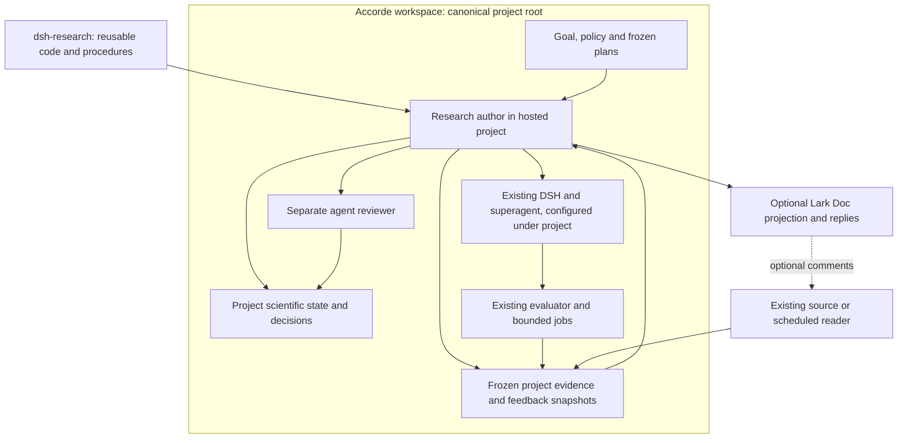

# dsh-research

dsh-research is a research skill, policy and thin-helper package over existing DSH and dsh-superagent facilities. It helps a hosted project connect a scientific question to bounded execution, trustworthy evidence, separate agent review and a justified next action.

The hosted project owns its scientific code, plans, decisions, evidence and persistent state. dsh-research owns reusable implementation and its own engineering records. Existing DSH facilities provide workers, jobs, communication, recovery and persistence; the package does not rebuild those services.

## What the package contributes

The [research-loop contract](docs/contracts.md) defines four small responsibilities:

- A manifest binding the original request, goal, candidate, evaluator, inputs, method, bounds and acceptance policy.
- Evidence checking against actual job terminal facts and the existing domain verifier.
- Checkpoint interpretation and evidence-backed continuation, diagnosis, pivot, hold or completion.
- Scoped review/admission checks over existing authoritative limits and confirmation history.

These are procedures and thin helpers, not four new services. Domain tools decide scientific adequacy. Existing DSH providers supply orchestration, jobs, communication and persistence.

## Architecture: reusable code, project-owned research



Accorde illustrates a hosted project researching GPU performance modeling, CUDA execution and profiling. Synthetic CPU examples exercise reusable helper mechanics. Package code supplies behavior; project configuration and records supply research authority. See the [M0 architecture plan](.plan/261105-1616-m0-architecture-workflows-and-idempotency.md).

## Project ownership and persistence

P is the explicitly configured canonical hosted-project root, independent of worker cwd, worktree or Session restart. Configure provider paths under P; keep active legacy locations authoritative until a verified handoff.

```text
P/
  src/ and tools/                     # shared scientific implementation and verifiers
  .plan/                              # deliberate plans/contracts and useful summaries
  .autoresearch/dsh/
    state.sqlite3                     # coupled project record via existing storage provider
    superagent/                       # native orchestration state
    sessions/                         # native Session persistence
    profile/                          # resolved package/provider/prompt pins
```

Project-owned artifact storage retains exploratory plans, immutable execution output, captured feedback and released bytes. dsh-research keeps its own deliberate plans and compact qualification receipts in Git. Raw fixture logs and supporting experimental drafts can use ignored local development artifacts. Hosted-project scientific records never become package-global state.

Worktrees and project clones cannot create fresh budgets, action consumption or confirmation history. Use existing provider paths and one coupled scientific writer; do not directly rewrite native databases or initialize empty substitutes. A Git clone alone does not include ignored scientific evidence and live state: full project recovery needs supported backups/exports and their linked artifact versions.

See the [state/autonomy contract](.plan/261105-1705-contract-project-state-autonomy-and-feedback.md) for the owner/location matrix and legacy continuity requirements.

## Execution, review and autonomy

The [research-loop contract](docs/contracts.md) specifies the stages, invariants and trace records. Actions pin its version/hash and qualified provider profile. Admission requires verifiable commit/order proof; missing separate review holds the dependent action.


The contract defines this research loop:

```text
goal and standing authority
  -> frozen bounded plan and manifest
  -> separate agent technical review and admission
  -> existing DSH worker/job and domain evaluator
  -> actual terminal evidence and immutable result
  -> project checkpoint and next justified action
```

Timeout, cancellation, crash, unknown execution and identity drift remain invalid or unresolved even when stdout says pass. A valid negative result remains useful evidence. Review binds the exact candidate, evidence, plan and action; changed identity requires applicable new review. Retries retain charges, and uncertain attempts keep their reservations until reconciled.

Normal execution, technical review, diagnosis, covered recovery and alternative selection continue autonomously within standing scope and resource policy. Optional comments or publication failures do not block admissible research. Human scientific steering follows independently challenged scoped exhaustion after orthogonal alternatives and a materially different rebrainstorm. Hard limits, missing permission and unresolved processes remain operational holds; explicit human stop is respected.

The synthetic CPU profile keeps fresh/sealed confirmation off. Enabled access requires its own qualified ordering, exposure-history and single-writer policy. Renaming a branch, profile or campaign cannot make exposed data fresh.

## Keeping source and plans manageable

Parameter trials share an implementation and retain distinct configurations. Implementation changes use source revisions. Group method-specific code by family and extract shared helpers when their assumptions and consumers justify it.

For existing main code, distinguish supported capabilities, compatible duplication, active methods, historical one-offs, generated material and frozen dependencies. Preserve/restore coherent historical source and exploratory plan families before removing eligible files from the default tree. Keep useful negative findings discoverable.

For integration, preserve the original evaluated snapshot and prepare a focused change containing reusable code, appropriate checks/docs, accepted deliberate plans and useful findings. Explorative per-attempt planning and raw outputs stay in retained artifacts. Record and verify the resulting integration tree; squashing does not reduce the merged file set or establish scientific validity.

The [clutter guidance](.plan/261109-1452-brainstorm-repo-clutter-and-team-artifacts.md) distinguishes deliberate work from explorative detail. Ignore rules do not untrack existing files, and ignored research artifacts still require retention and sharing.

## Team sharing and feedback

Use existing Lark/Feishu surfaces at three levels: a short brief for catching up, permitted evidence for assessing a claim, and a source/config/input bundle for reproduction. Verify access to underlying figures, source and data as well as the Doc. Local Session paths are not shared artifacts.

Keep exact released bytes, content hashes, stable cloud identities and publication status in the hosted project. Use native permissions for different audiences; raw Session logs, secrets, private labels and restricted verifier output do not enter ordinary releases. Lark is a view and feedback source, not the only surviving scientific record.

The feedback loop must close:

```text
captured comment version
  -> project disposition and reason
  -> changed frozen action if adopted
  -> agent review and actual executed/failed/pending effect
  -> response with decision and evidence links
```

Preserve human comment-bearing regions during narrow revision-aware updates. Reconcile uncertain publication before retrying. A publication retry cannot launch another experiment or reset budget. The [sharing guidance](.plan/261105-1621-plan-lark-research-review-and-sharing.md) describes capture, assessment, effect and response checks.

## Architecture revision and migration

The [1604 architecture meta loop](.plan/261111-1604-architecture-meta-loop-and-migration.md) governs revisions of dsh-research's own architecture. Enter after separate agent review establishes a materially blocked accepted core requirement, an architectural cause, and a narrower supported repair that has failed or been concretely ruled out. The trigger table specifies justification and required evidence against a pinned [loop contract](docs/contracts.md) and observed native traces. Routine bugs and project changes remain triage signals. A justified requirement revision is a parallel reviewed path; structural entry binds current evidence, and adoption must regress applicable properties and the original witness.

Compare the current architecture, a narrow repair and an end-to-end alternative. Freeze revised contracts, expected benefit, complete cost and migration/rollback after separate agent review. Qualify through disposable fixtures and non-executing shadow interpretation; shadow must not launch work or mutate authority.

Keep active runs pinned until terminal/reconciled. Rehearse supported backup/restore, use a charged released-input canary, and fence the old writer at a supported safe boundary. Preserve charges, reservations, consumed actions/reviews, feedback and publication associations, and exposure history. Rollback changes compatible code/profile; it cannot overwrite post-cutover consumption with a stale backup. Retirement follows dependency and restoration checks.

Implementation progress, qualification evidence and next work for M1–M6 are maintained in the [implementation tracker](.plan/tracker/261105-1555-milestone-execution.md). Repository policy is in [AGENTS.md](AGENTS.md).

## Deliberate branching vs explorative branching

- **Deliberate:** work with a defined scope and deliverable. Version its accepted plans, contracts and useful compact evidence.
- **Explorative:** work investigating uncertain alternatives. Retain detailed planning in project artifacts outside Git and summarize useful findings.

Exploration becomes deliberate when its purpose, bounds and intended outcome are defined and reviewed. Large/raw outputs stay in artifacts for either category. See the [planning guidance](.plan/261109-1452-brainstorm-repo-clutter-and-team-artifacts.md) for the full criteria.

## Development checks

Use Node >=24.9 and the pinned pnpm version. The TypeScript package lives in `helpers/`; canonical docs and the research skill remain at the repository root. From this checkout:

```sh
cd helpers
npx --yes pnpm@11.7.0 install --frozen-lockfile --ignore-scripts
npx --yes pnpm@11.7.0 build
npx --yes pnpm@11.7.0 typecheck
npx --yes pnpm@11.7.0 test

dsh_check_root=$(mktemp -d "${TMPDIR:-/tmp}/dsh-research-checks.XXXXXX")
npx --yes pnpm@11.7.0 m1:smoke "$dsh_check_root/compatibility"
npx --yes pnpm@11.7.0 m2:smoke "$dsh_check_root/synthetic-cpu"
npx --yes pnpm@11.7.0 m3:smoke "$dsh_check_root/automatic"
npx --yes pnpm@11.7.0 m4:smoke "$dsh_check_root/faults"
npx --yes pnpm@11.7.0 m6:smoke "$dsh_check_root/continuity"
```

The smoke commands require a fresh output directory and write their records and traces there. The compatibility check covers record encodings and public SQLite/DSH operations. The synthetic CPU example exercises the guarded worker/reviewer route, reservation, evidence, replay and failure handling. The continuity example rehearses an idle SQLite backup, linked artifact export and native restore under the original canonical project identity.

See the [native integration guide](docs/integration.md) for the proposal/review/feedback tools, project configuration and read-only audits.

The package includes a generated qualification-lock snapshot and the [research skill](skills/research/SKILL.md). Core helpers are exported from `dsh-research`; the native adapter is exported from `dsh-research/native` with optional exact-version DSH peers. It accepts synthetic CPU and bounded `project_gpu_development` qualification policies and requires registered project state. GPU qualification binds an exact device, lease namespace and host-registered termination guard; scientific GPU adoption uses its separate project qualification gate. Native jobs are process-local; an unresolved launch retains its project reservation after reopen.

## Revision History

| Revision | Timestamp | Change |
|---|---|---|
| r1 | 2026-11-11 16:14 -0800 | Added a plan-grounded README emphasizing deliberate versus explorative branching, package/project ownership, autonomy, evidence/sharing, architecture revision, migration and pending implementation status. |
| r2 | 2026-11-11 16:29 -0800 | Aligned the architecture entry summary with 1604's package-specific, evidence-qualified structural gate; routine signals no longer imply redesign. |
| r3 | 2026-11-11 16:34 -0800 | Shortened the branching overview to definitions and storage guidance; linked the detailed planning criteria. |
| r4 | 2026-11-11 16:45 -0800 | Added the reusable-code/project-owned-research Mermaid figure from M0 with a short explanatory caption. |
| r5 | 2026-11-11 17:07 -0800 | Linked canonical research-loop contract 1.0.0, pinned stage/invariant/trace semantics and retained prospective runtime qualification and project authority. |
| r6 | 2026-11-11 18:12 -0800 | Adopted human-review contract 2.1.0 clarifications in current references/qualification plans; retained pending runtime guarantees and historical bindings. |
| r7 | 2026-11-11 20:22:19 -0800 | Aligned README with current contract 2.3.0 and retained 2.1.0 r6 as historical. |
| r8 | 2026-11-11 20:31:48 -0800 | Adopted 2.3.1 accepted-envelope amortization, owned qualification holds and explicit T4 C_run/C_qual evidence without runtime activation. |
| r9 | 2026-11-11 21:13:38 -0800 | Adopted cumulative 2.3.2 compatibility assessment and explicit qualification-budget/envelope arbitration without runtime execution. |
| r10 | 2026-11-11 21:39:00 -0800  | Documented runnable M1 package/fixture checks, contract 2.3.3 bindings and tested-versus-pending scope; preserved concise branching guidance and architecture figure. |
| r11 | 2026-11-11 22:08:03 -0800 | Recorded M2 native helper/skill/packed-example implementation, runnable checks and exact tested-versus-pending scope; preserved concise branching guidance and the architecture figure. |
| r12 | 2026-11-11 22:41:00 -0800 | Removed private artifact paths and duplicate milestone status/next-work content; linked the canonical implementation tracker and retained portable usage, architecture, branching guidance and historical revisions. |
| r13 | 2026-11-11 23:30:50 -0800 | Added portable automatic workflow/fault check commands and stable integration guidance; implementation status remains solely in the tracked milestone record. |
| r14 | 2026-11-12 00:07:50 -0800 | Grouped package configuration, source, tests, scripts and examples under helpers; build emits canonical docs and skill copies, and a portable native continuity rehearsal. |
| r15 | 2026-11-12 00:30:09 -0800 | Clarified Accorde's GPU scientific target and the helper purpose of synthetic CPU examples. |
| r16 | 2026-11-12 11:04:59 -0800 | Documented the bounded GPU qualification guard and retained stable usage/project ownership; current execution status remains in the tracker. |
